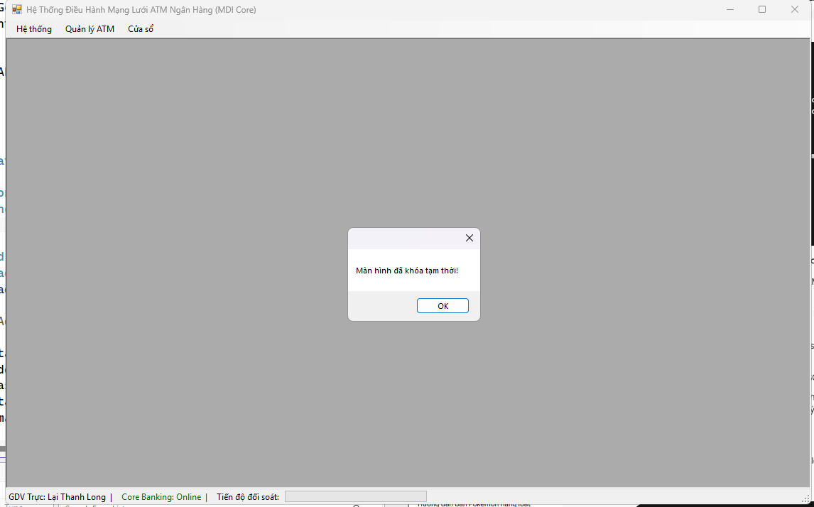
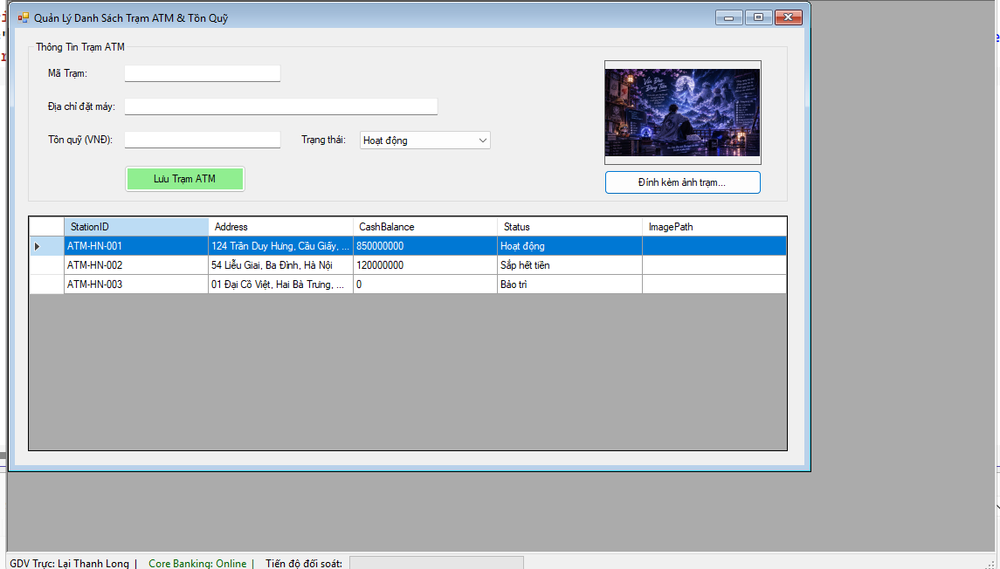
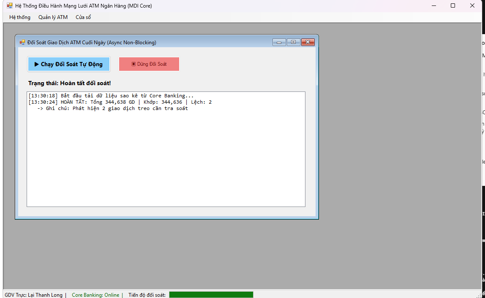
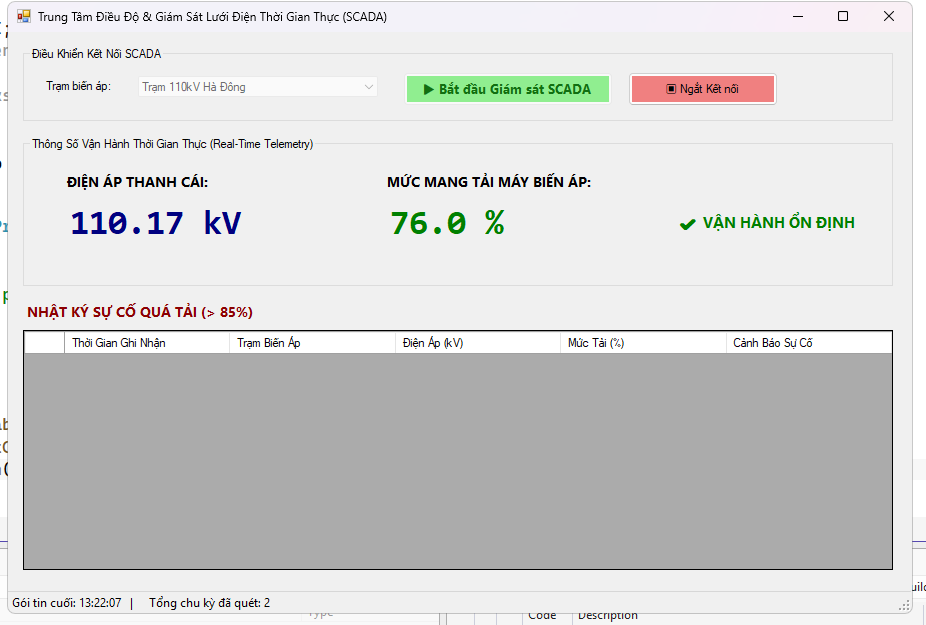
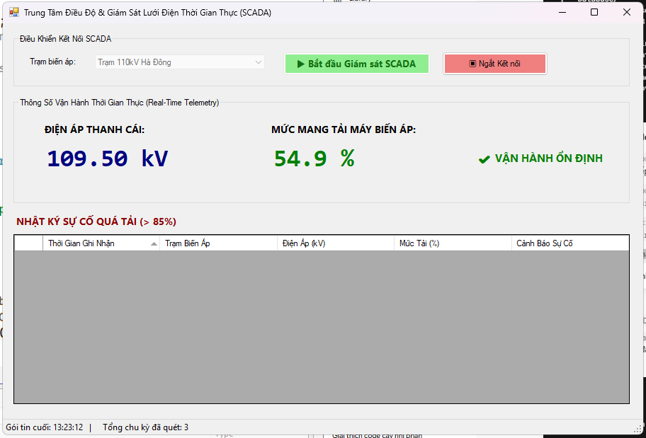

# Bài Tập Thực Hành .NET: Bài 6.6 (MDI ATM) & Bài 6.7 (SCADA Lưới Điện)

## Thông tin sinh viên

- **Họ và tên:** Lại Thanh Long
- **MSV:** 24810310231

---

## Cấu trúc thư mục

- `BankAtmMdiApp/`: Source code Bài 6.6 - Hệ thống điều hành mạng lưới ATM (MDI Container + Async/Await).
- `PowerGridScadaApp/`: Source code Bài 6.7 - Hệ thống giám sát lưới điện thời gian thực (SCADA + Thread-Safe UI).
- `Database/`: Chứa 2 file script SQL (`BankAtmDB.sql` và `PowerGridDB.sql`).
- `screenshots/`: Ảnh chụp màn hình kết quả chạy chương trình.

---

## Hướng dẫn cài đặt & chạy

1. Mở **SQL Server Management Studio (SSMS)**, chạy 2 file script trong thư mục `Database/` để tạo `BankAtmDB` và `PowerGridDB`.
2. Mở file `App.config` trong từng project, sửa `Data Source=.\SQLEXPRESS` thành tên SQL Server trên máy của bạn.
3. Mở project bằng **Visual Studio** và nhấn `F5` để chạy.

---

## Kết quả chạy chương trình

### Bài 6.6: Hệ thống MDI Quản lý Trạm ATM

**1. Giao diện chính MDI & Sắp xếp cửa sổ con**

**2. Quản lý Danh sách Trạm ATM & Đính kèm ảnh**

**3. Đối soát giao dịch cuối ngày (Async Non-Blocking)**

---

### Bài 6.7: Giám sát Lưới điện Thời gian thực (SCADA)

**1. Trạng thái vận hành ổn định**

**2. Trạng thái cảnh báo quá tải (> 85%) & Ghi log SQL**

